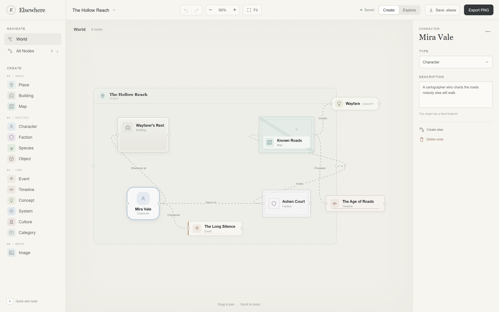
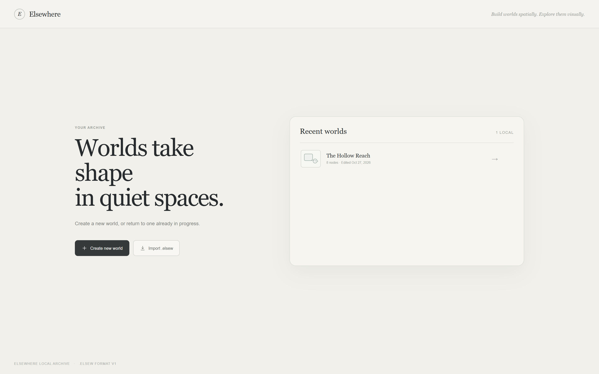
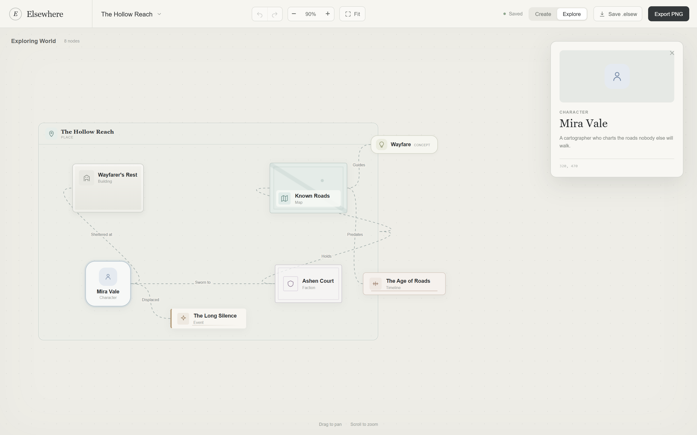

# Elsewhere

A quiet, local-first worldbuilding studio for macOS. Elsewhere turns a setting into a spatial canvas: place characters, places, factions and lore on the page, draw the relations between them, and step back into a read-only Explore view when the world is ready to be read.

Built with Tauri 2, React, TypeScript, and SQLite. No accounts, no cloud, no telemetry.







## Download

Download the latest universal build for macOS 12 or newer (Apple Silicon and Intel) from [Releases](https://github.com/Phanstal/Elsewhere-Worldbuilder/releases/latest):

- `Elsewhere_0.1.0_universal.dmg`
- `Elsewhere_0.1.0_universal.zip`
- `SHA256SUMS.txt`

Verify the download before opening it:

```sh
shasum -a 256 -c Elsewhere_0.1.0_universal.dmg.sha256
```

### First launch

The app is **unsigned and not notarized** (personal distribution, no Apple Developer ID). macOS Gatekeeper will warn on first launch:

1. Open the DMG and drag `Elsewhere.app` to `/Applications`.
2. Right-click the app, choose **Open**, then **Open** again. Or use **System Settings → Privacy & Security → Open Anyway**.
3. If macOS says the app is damaged, clear the quarantine flag:

```sh
xattr -dr com.apple.quarantine /Applications/Elsewhere.app
```

Because every build is ad-hoc signed rather than notarized, you may need to repeat this after installing a new release.

## What it does

- **Spatial canvas**: a dot-grid world of fixed proportions. Pan with the background, zoom with the wheel or trackpad, and use **Fit** to bring everything back into view.
- **14 node types**: Place, Building, Map, Character, Faction, Species, Object, Event, Timeline, Concept, System, Culture, Category, and Image, grouped as Space / Entities / Lore / Media. Place and Category are resizable containers; the rest have fixed, deliberate footprints.
- **Relations**: drag from either side of a node and drop on another to create a named relation. Relation labels sit on the curve and can be renamed in place or from the inspector.
- **Aliases**: a character can appear in two parts of the map without becoming two characters. Aliases share the source node's title, type, and description, and are counted separately from base nodes.
- **Inspector**: edit a node's title, type, description, position, and aliases; edit or delete a selected relation.
- **Create / Explore**: Create mode exposes the sidebar and inspector. Explore mode hides the editing chrome and opens a quiet read-only card for any node you click.
- **Autosave**: changes land in a local SQLite database after a short debounce, with `Saving…` / `Saved` feedback. Undo and redo are available from the toolbar and `⌘Z` / `⇧⌘Z`.
- **`.elsew` files**: a readable, versioned JSON format. Save the current world, or import a world as a new entry in the archive; imports never overwrite existing worlds.
- **PNG export**: render the whole world, including the dot grid and relation lines, at 2× resolution through a native save dialog.
- **Example world**: [samples/the-hollow-reach.elsew](samples/the-hollow-reach.elsew) is the world in the screenshots. Import it from the archive to try the app.

## Keyboard and trackpad

| Action                           | Shortcut               |
| -------------------------------- | ---------------------- |
| Create a world                   | `⌘N`                   |
| Save now                         | `⌘S`                   |
| Undo / redo                      | `⌘Z` / `⇧⌘Z`           |
| Zoom in / out                    | `⌘+` / `⌘-`            |
| Fit the world                    | `⌘0`                   |
| Quick add node                   | `N`                    |
| Toggle Explore / Create          | `⇧⌘O`                  |
| Export `.elsew`                  | `⇧⌘E`                  |
| Export PNG                       | `⇧⌘P`                  |
| Rename a node on the canvas      | Double-click its title |
| Rename a relation                | Double-click its label |
| Cancel selection / close a panel | `Esc`                  |

## Your data

The SQLite database lives at:

```text
~/Library/Application Support/com.phanstal.elsewhere/elsewhere.db
```

Back it up with Time Machine or by copying that file while Elsewhere is closed. Removing the app does not remove the database; delete the folder above if you want a clean slate.

The browser build used for development and Playwright stores worlds in `localStorage` under `elsewhere.worlds.v1`. It is a full local adapter, not a demo mode.

## The `.elsew` format

```json
{
  "format": "elsew",
  "version": 1,
  "id": "0ccf4b9a-6b7d-4c4e-9e4a-1f2d3c4b5a69",
  "name": "The Hollow Reach",
  "updatedAt": "2026-10-27T07:09:42.878Z",
  "nodes": [
    {
      "id": 104,
      "title": "Mira Vale",
      "type": "Character",
      "x": 320,
      "y": 470,
      "description": "A cartographer who charts the roads nobody else will walk."
    }
  ],
  "relations": [{ "id": 201, "from": 104, "to": 105, "name": "Sworn to" }]
}
```

- `format` must be `elsew`, `version` must be `1`.
- Node IDs may be numbers or the millisecond timestamps produced by the original prototype.
- Missing `width` / `height` fall back to the type's default footprint.
- A bad file is rejected with a readable message instead of being partially imported.

The format is intentionally plain JSON: it can be read, diffed, repaired by hand, and moved between machines without a database.

## Development

Prerequisites:

- Node.js 22 or newer
- Rust stable (`rustup`)
- macOS: Xcode Command Line Tools
- Windows: Visual Studio C++ build tools and WebView2
- Linux: the usual Tauri 2 WebKitGTK dependencies

```sh
npm install
npm run dev          # browser mode, localStorage adapter, hot reload
npm run tauri dev    # native window, SQLite adapter
```

Checks:

```sh
npm run lint
npm run format:check
npm run typecheck
npm test             # Vitest: domain, .elsew parsing, local repository
npm run build
npx playwright install chromium
npm run test:e2e     # builds, serves the production bundle, runs Playwright
cargo test --manifest-path src-tauri/Cargo.toml
cargo clippy --manifest-path src-tauri/Cargo.toml --all-targets -- -D warnings
```

The E2E suite uses Chromium. On a Windows machine without Playwright's browser installed, set `PLAYWRIGHT_CHANNEL=msedge` to reuse the installed Edge:

```powershell
$env:PLAYWRIGHT_CHANNEL = 'msedge'
npm run test:e2e
```

Build a universal macOS app locally:

```sh
rustup target add aarch64-apple-darwin x86_64-apple-darwin
npm run tauri build -- --target universal-apple-darwin --bundles app
```

## Architecture

```text
React views (archive, studio, canvas, inspector)
        │
        ├── domain: types, world operations, .elsew parsing, repository port
        ├── infra/storage: SQLite adapter (Tauri desktop)
        │                  localStorage adapter (browser + E2E)
        ├── infra/export: native .elsew save and 2× PNG rendering
        └── platform: Tauri detection, native menu command bus, save dialog
        │
Rust shell (src-tauri): plugins, menus, window config, save_export command
```

The domain and storage ports have no React dependency. That is what keeps the model portable to a future iOS or Android target without rewriting the world operations or the file format.

Read [docs/architecture.md](docs/architecture.md) for the detailed decisions, schema, save pipeline, undo transactions, and mobile-porting plan. The design contract and frozen reference assets are in [docs/design](docs/design).

## Why Tauri instead of SwiftUI?

The target was a Mac app that can later become an iPhone or Android app. Tauri 2 gives a native window and menus today, a React/SVG world canvas that runs well in WKWebView, and a documented mobile path later. The trade-off is a WebView-based UI and a Rust toolchain; for a single-window, local-first canvas that is a good exchange. SwiftUI would be excellent for Mac-only, but would require a second implementation for mobile.

## Privacy

Elsewhere has no network code, no analytics, no account system, and no synchronization. The only file writes outside its own database are the `.elsew` and PNG files you explicitly choose in a save dialog.

## Known limitations

- No Apple signing or notarization; first launch needs manual approval, and each new build may need it again.
- No auto-update, cloud sync, accounts, collaboration, or version history beyond the in-session undo stack.
- The world is fixed at 1100 × 680; nodes cannot be rotated, and only Place and Category can be resized.
- Relations are named two-node links; no routing points or multi-edge groups.
- No image upload for Image nodes yet; the shape is present, the media workflow is not.
- The interface is English only, matching the prototype.

## Design

The interface is based on the [Elsewhere Figma Make prototype](https://www.figma.com/make/aeRRMdDfVsyuJvz2Dy1DV3/Build-Elsewhere-Worldbuilding-Studio?t=Y0SPn1WcqeAIuBMw-1). Figma Make files are not supported by the Figma MCP server, so the prototype's CSS, exported world, and reference screenshots were frozen into [docs/design](docs/design) and used as the visual contract. See [docs/design/README.md](docs/design/README.md) for tokens and intentional deviations.
