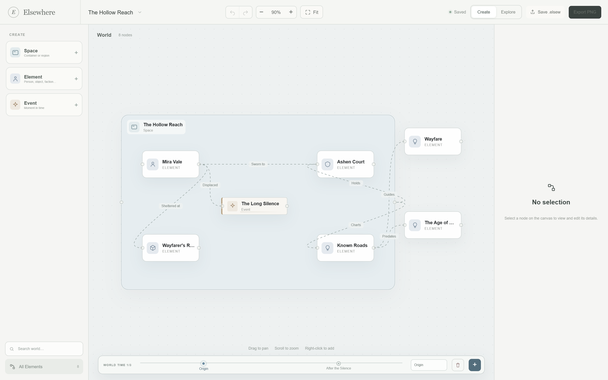
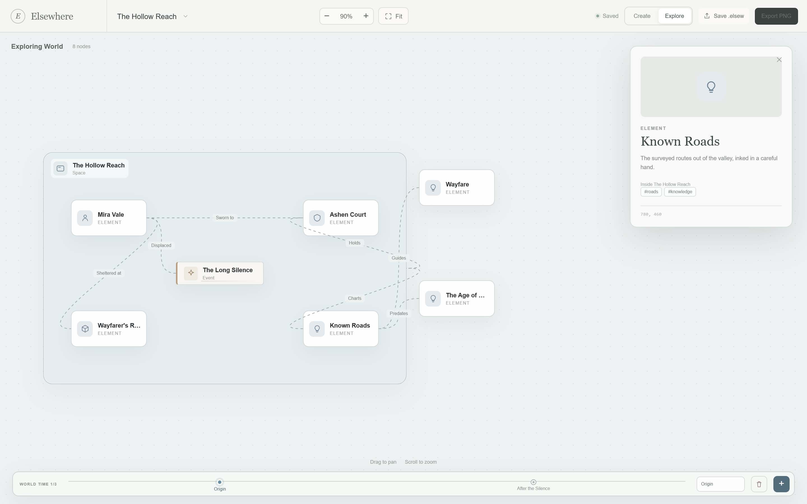

# Elsewhere v0.1.2

A redesigned studio, built around the Version 33 Figma Make prototype: fewer, broader node types, a world timeline, and a calmer canvas.





## What's new

- **Version 33 studio redesign** — 210 px create sidebar, blue-gray dot-grid canvas, 270 px inspector, centred zoom / Fit controls, and a new bottom **World time** track.
- **Three broad create types** — **Space** (“Container or region”), **Element** (“Person, object, faction…”), and **Event** (“Moment in time”). Imported worlds that use the older 14 types still render and can be edited.
- **World time snapshots** — up to three states per world. Switch, rename, add, or delete a moment; each time node keeps its own nodes and relations. Existing worlds open with an `Origin` snapshot.
- **Element detail** — character / faction / concept / object icons, tags, Space parent, and image upload.
- **Space detail** — background color, resizable 560 × 360 regions, a list of what is inside, and moving a Space brings its contents with it.
- **Canvas workflow** — right-click to create Space / Element / Event / Image, drag an image file onto the canvas, double-click a title or relation to rename, and drag nodes into a Space to parent them.
- **All Elements drawer** — search the world and jump to any base node from the bottom of the sidebar.
- **Explore mode** — a read-only card with the element image, type, description, parent Space, tags, and position.
- **PNG export** — the redesigned canvas and relations now export at 2× with the correct styles, grid, and labels.
- **Updated sample** — [`samples/the-hollow-reach.elsew`](https://github.com/Phanstal/Elsewhere-Worldbuilder/blob/main/samples/the-hollow-reach.elsew) now uses Space / Element / Event and includes two time snapshots.

Existing SQLite worlds and v0.1.0 `.elsew` files are compatible. They are normalized to the new model and given an `Origin` snapshot on open.

## Install

Download `Elsewhere_0.1.2_universal.dmg` (Apple Silicon and Intel, macOS 12+) and drag `Elsewhere.app` to `/Applications`.

This build is **unsigned and not notarized**. On first launch:

1. Right-click `Elsewhere.app`, choose **Open**, then **Open** again.
2. Or open **System Settings → Privacy & Security** and choose **Open Anyway**.
3. If macOS reports the app is damaged:

```sh
xattr -dr com.apple.quarantine /Applications/Elsewhere.app
```

Verify the download:

```sh
shasum -a 256 -c Elsewhere_0.1.2_universal.dmg.sha256
```

SHA-256 checksums are listed in `SHA256SUMS.txt` on the release page.

## Known limitations

- No Apple signing, notarization, or auto-update.
- No cloud sync, accounts, collaboration, or version history beyond the current undo stack.
- World time is limited to 3 snapshots; there is no merge or diff between moments.
- World size is fixed at 1100 × 680; nodes cannot be rotated; only Space (and legacy Place / Category) resize.
- Images are stored inline in the world file; there is no crop, frame, or media library yet.
- English interface only.

The full acceptance checklist is in [docs/acceptance.md](https://github.com/Phanstal/Elsewhere-Worldbuilder/blob/main/docs/acceptance.md).

## Verification

- 23 Vitest unit tests, 11 Playwright E2E tests
- lint, Prettier check, TypeScript, production build
- Rust fmt, Clippy (`-D warnings`), cargo tests
- Universal macOS `.app` built on `macos-15`, ad-hoc signed, packaged as DMG + ZIP with SHA-256 checksums
