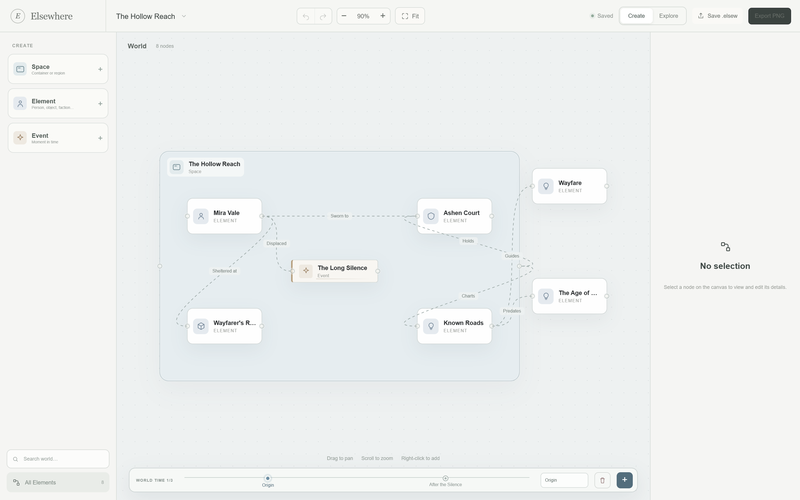

# Elsewhere v0.1.3

A window-dragging fix on macOS.



## What's fixed

- **Dragging a window now works whenever the app is active.** Elsewhere uses a native, transparent macOS title bar instead of `titleBarStyle: "Overlay"`. The web content starts below the title bar, so AppKit owns the drag region. The first click, and every click after that, behaves the same whether the window is active or inactive.
- **Removed the frontend drag workaround.** `data-tauri-drag-region` is gone from the home header and studio toolbar; no `-webkit-app-region` rules remain. The 82 px left inset that reserved space for the overlay traffic lights is gone too, so the brand and toolbar start at their normal padding.
- **Window background is now `#fcfcfa`**, matching the paper surface around the native title bar.
- **Native traffic lights, application menus, and window-state restore are unchanged.** The title text stays hidden, and the window is dismissible, minimizable, zoomable, and resizable as before.
- Everything in [v0.1.2](https://github.com/Phanstal/Elsewhere-Worldbuilder/releases/tag/v0.1.2) is included: the Version 33 studio, Space / Element / Event, world time, Element icons and images, and PNG export.

This specifically avoids the Tauri overlay-title-bar limitation tracked in [tauri-apps/tauri#15623](https://github.com/tauri-apps/tauri/issues/15623): `Transparent` leaves the standard content frame, while `Overlay` makes the WKWebView cover the title bar.

## Install

Download `Elsewhere_0.1.3_universal.dmg` (Apple Silicon and Intel, macOS 12+) and drag `Elsewhere.app` to `/Applications`.

This build is **unsigned and not notarized**. On first launch:

1. Right-click `Elsewhere.app`, choose **Open**, then **Open** again.
2. Or open **System Settings → Privacy & Security** and choose **Open Anyway**.
3. If macOS reports the app is damaged:

```sh
xattr -dr com.apple.quarantine /Applications/Elsewhere.app
```

Verify the download:

```sh
shasum -a 256 -c Elsewhere_0.1.3_universal.dmg.sha256
```

SHA-256:

```text
718e63412f38e8e4f106bbce12fbbb219ceeed9c58dd627e85fa3173d5ad1f70  Elsewhere_0.1.3_universal.dmg
e53d00888b7c5cf32e21dc6fdab5fb78481af3846c616b3937f4c95ba200949f  Elsewhere_0.1.3_universal.zip
```

Sizes: DMG 10,321,780 bytes; ZIP 9,312,576 bytes. The same values are published in `SHA256SUMS.txt`.

## Known limitations

- No Apple signing, notarization, or auto-update.
- No cloud sync, accounts, collaboration, or version history beyond the current undo stack.
- World time is limited to 3 snapshots; there is no merge or diff between moments.
- World size is fixed at 1100 × 680; nodes cannot be rotated; only Space (and legacy Place / Category) resize.
- Images are stored inline in the world file; there is no crop, frame, or media library yet.
- English interface only.

The full acceptance checklist is in [docs/acceptance.md](https://github.com/Phanstal/Elsewhere-Worldbuilder/blob/main/docs/acceptance.md).

## Verification

- 23 Vitest unit tests, 11 Playwright E2E tests
- lint, Prettier check, TypeScript, production build
- Rust fmt, Clippy (`-D warnings`), cargo tests
- Universal macOS `.app` built on `macos-15`, ad-hoc signed, packaged as DMG + ZIP with SHA-256 checksums
- Window drag must be confirmed on a real Mac; this Windows development machine cannot exercise AppKit title-bar dragging.
